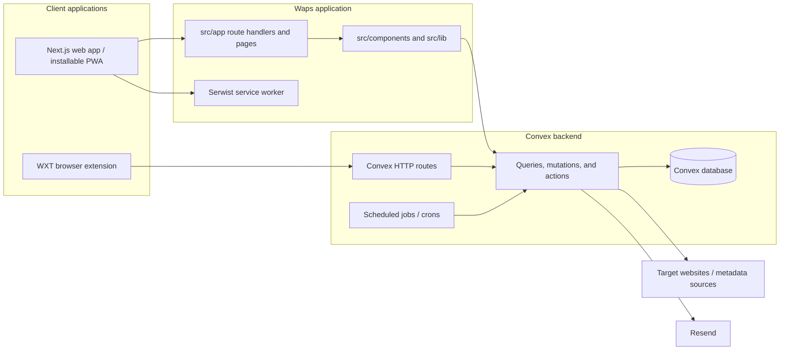
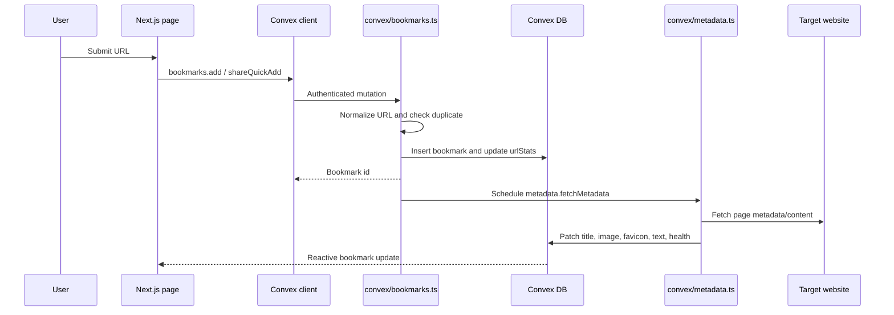
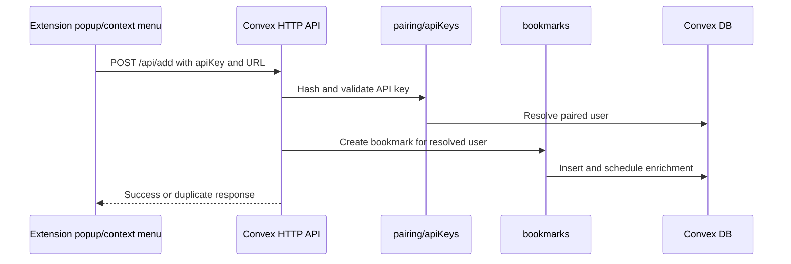
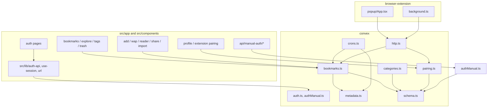
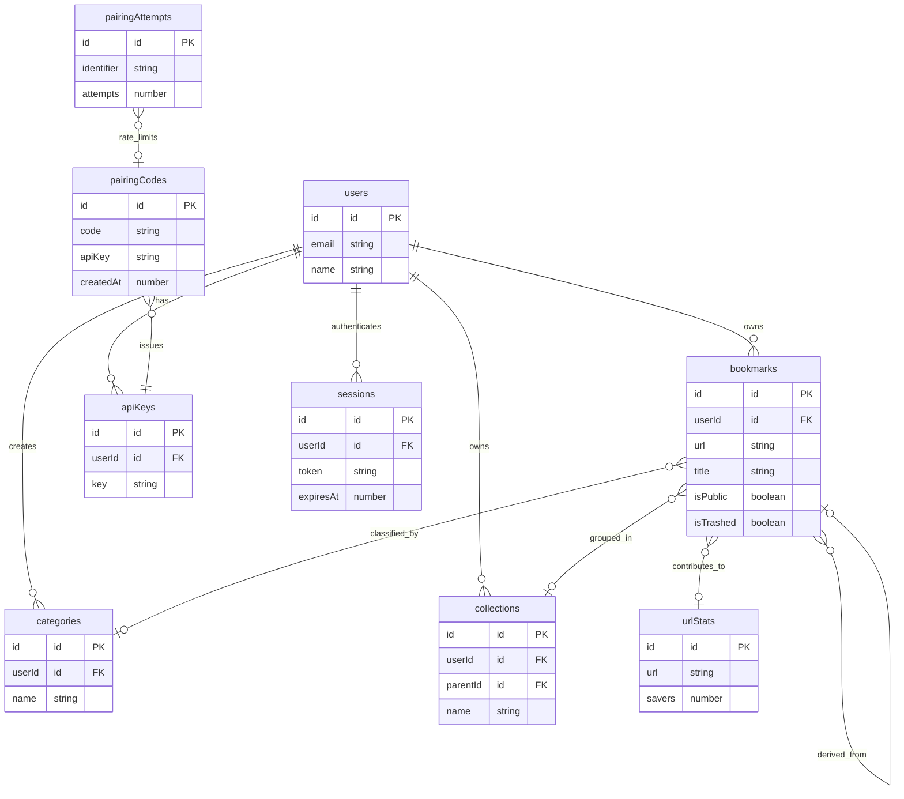

# Waps architecture graph

This document is the codebase map for Waps. It describes the current implementation in `src/`, `convex/`, and `browser-extension/`; arrows represent runtime calls or data ownership, not merely folder proximity.

## System boundary

## Main data and request flows

### Save a wap from the web app

### Save a wap from the extension

## Module graph

## Data model

## Route-to-capability inventory

| Area                    | Entry points                                           | Backend capability                                                  |
| ----------------------- | ------------------------------------------------------ | ------------------------------------------------------------------- |
| Authentication          | `src/app/(auth)/*`, `src/app/api/manual-auth/*`        | `convex/auth.ts`, `convex/authManual.ts`, `sessions`, `resetTokens` |
| Personal library        | `src/app/(tabs)/bookmarks`, `add`, `wap/[id]`, `trash` | `convex/bookmarks.ts`                                               |
| Discovery and sharing   | `explore`, `share/[publicId]`, `u/[userId]`            | Public bookmark queries in `convex/bookmarks.ts`                    |
| Organization            | `tags`, category controls, collection fields           | `convex/categories.ts`, bookmark tag/collection mutations           |
| Reading and enrichment  | `reader/[id]`                                          | `convex/metadata.ts` and bookmark metadata fields                   |
| Browser extension       | `extension`, profile pairing UI, WXT popup/background  | `convex/pairing.ts`, `convex/http.ts`                               |
| Background maintenance  | Convex deployment                                      | `convex/crons.ts`                                                   |
| Offline/installable app | `manifest.json`, `sw.ts`, `pwa-register.tsx`           | Serwist service worker and browser cache                            |

## Important implementation notes

- The web app uses the Convex React client for reactive reads and writes; manual-auth API routes exist alongside Convex Auth tables and should be treated as a separate authentication surface.
- Extension traffic does not use the browser app's React client. It calls Convex HTTP endpoints with a paired API key.
- Metadata extraction is asynchronous. A bookmark can be created before title, image, favicon, article text, or link-health fields are available.
- `convex/schema.ts` is the source of truth for persisted entities and indexes. Generated files under `convex/_generated/` are build artifacts and are intentionally omitted from the graph.
- The repository README mentions `convex/collections.ts`, but no such file currently exists; collection data and mutations are presently represented through `schema.ts` and `bookmarks.ts`.

## Keeping this graph current

Update this file when adding a new client, Convex module, HTTP endpoint, persisted table, scheduled job, or external integration. Prefer adding an edge to the relevant Mermaid graph and one row to the inventory rather than duplicating implementation details.
